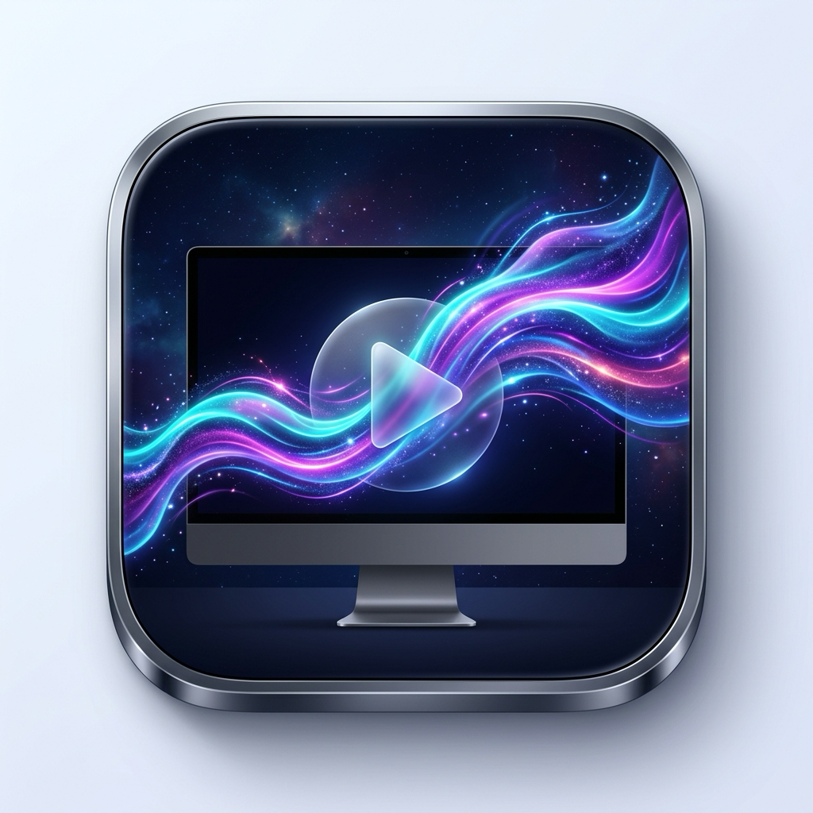

# 🎬 Live Wallpaper Studio

<p align="center">
  
</p>

<p align="center">
  <strong>A flagship, completely free, ultra-low-power live video wallpaper studio.</strong><br>
  Engineered for macOS, Windows, Linux, Android, and iOS.
</p>

<p align="center">
  
  
  
  
</p>

---

## 🌟 Highlights

* **100% Free & Open Source**: No subscriptions, no ads, no paywalls.
* **Hardware-Accelerated Decoding**: Direct GPU/Media Engine decoding via VideoToolbox, DirectX, VA-API, and ExoPlayer for **< 0.6% CPU usage**.
* **Live Lock Screen Video Support**: Seamless moving video support for both desktop background and lock screens.
* **Smart Battery Armor**: Auto-pauses on display sleep, screen lock, full-screen gaming, or battery saver mode.
* **Multi-Display & Playlist Engine**: Independent monitor controls, aspect ratio scaling, drag-and-drop video imports, and auto-shuffle cycling.

---

## 🖥️ Platform Support & Architecture Matrix

| Platform | Desktop / Home Engine | Lock Screen Engine | Hardware Acceleration | Status |
| :--- | :--- | :--- | :--- | :--- |
| **macOS** | AppKit `NSWindow` + `AVPlayerLooper` | Native `ScreenSaverView` + Aerial Injection | Apple Silicon VideoToolbox | ✅ **Production Ready** |
| **Windows** | `Progman` / `WorkerW` Reparenting | Windows Lock Screen API | Windows Media Foundation / DX11 | 🛠️ In Progress (`platforms/windows`) |
| **Linux** | Wayland Layer-Shell / X11 `xwinwrap` | Lock Screen daemon integration | VA-API / VDPAU | 🛠️ In Progress (`platforms/linux`) |
| **Android** | `WallpaperService` + `SurfaceHolder` | Natively supported (`FLAG_LOCK`) | Android Media3 / ExoPlayer | 🛠️ In Progress (`platforms/android`) |
| **iOS** | Static Frame / Motion Live Photo | Paired Live Photo Motion Wallpaper | Apple ImageIO / PhotoKit | 🛠️ In Progress (`platforms/ios`) |

---

## 🚀 Quick Start (macOS)

Your Mac includes native Swift Command Line Tools out of the box. You can build and run in under 5 seconds:

```bash
# 1. Clone the repository
git clone https://github.com/your-username/live-wallpaper.git
cd live-wallpaper

# 2. Build the native Studio app & ScreenSaver
bash build_native.sh

# 3. Launch Live Wallpaper Studio
open LiveWallpaper.app
```

Look for the **🎬** icon in your Mac's top menu bar and open the full Studio window!

---

## 📦 How to Package for Sharing (`.dmg` & `.zip`)

To package a standalone installer for your friends:

```bash
bash package_dmg.sh
```

Generates:
* **`LiveWallpaper.dmg`**: Classic drag-and-drop macOS installer.
* **`LiveWallpaper.zip`**: Portable compressed archive for AirDrop / messaging.

---

## 📂 Repository Structure

```text
├── AppIcon.png                # High-res official application icon
├── build_native.sh            # ⚡ 1-click build script for macOS
├── package_dmg.sh             # 📦 Packages app into .dmg & .zip
├── set_native_lockscreen.sh   # 🔒 Injects videos into macOS Aerial lock screens
├── native/
│   ├── main.swift             # SwiftUI macOS 27 Golden Gate Studio
│   └── saver.swift            # Native 60 FPS Lock Screen ScreenSaver plugin
├── lib/
│   └── main.dart              # Flutter cross-platform control panel
├── platforms/
│   ├── windows/               # Windows WorkerW / Win32 architecture
│   ├── linux/                 # Linux Wayland / X11 scripts & specs
│   ├── android/               # Android WallpaperService Kotlin blueprint
│   └── ios/                   # iOS Motion Live Photo architecture
├── .github/workflows/         # Multi-platform CI workflows
└── LICENSE                    # MIT Open Source License
```

---

## 🤝 Contributing

Contributions are warmly welcomed! Please check [CONTRIBUTING.md](CONTRIBUTING.md) to get started.

---

## 📜 License

Distributed under the **MIT License**. See [LICENSE](LICENSE) for details.
